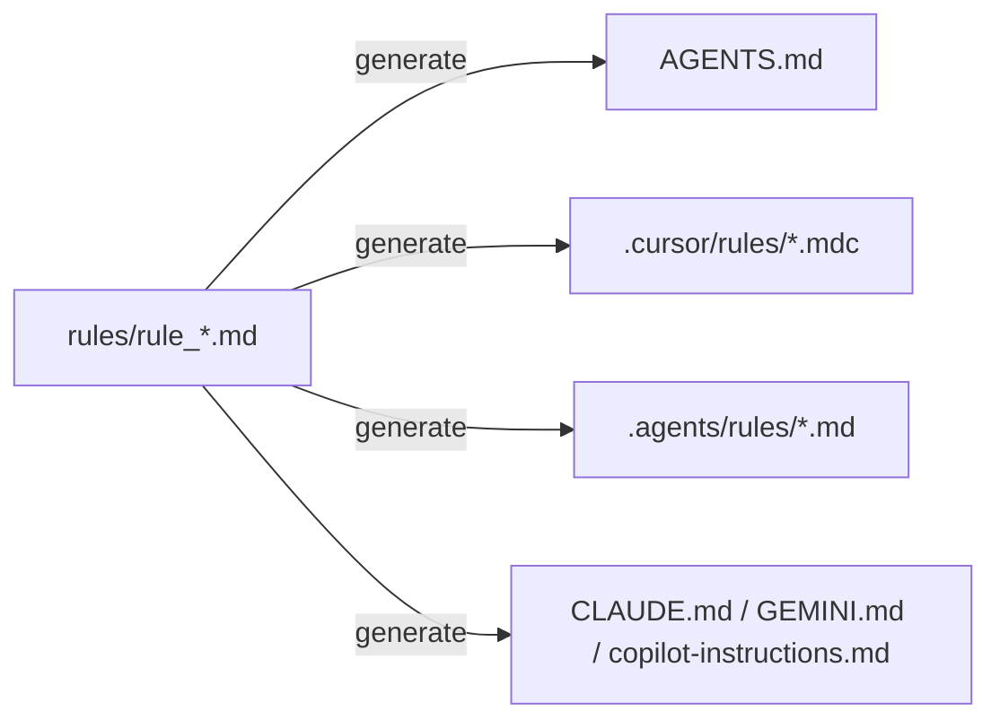

# Kuro Rules ⬛

Centralized AI coding guidelines and configuration for all my projects.

## How It Works (Generate Once, Copy Everywhere)

This repository contains the **master copies** of your rules (`rules/rule_*.md`
+ `rules/_metadata.yaml` + `VERSION`). The canonical generator vendors them
into every agent format:

```bash
python scripts/generate_targets.py --dry-run   # preview (default)
python scripts/generate_targets.py --check     # CI drift check
python scripts/generate_targets.py --apply     # write all targets
```



```text
kuro-rules/AGENTS.md ──copy──▶ Sugar/AGENTS.md
kuro-rules/.cursor/rules/*.mdc ──copy──▶ Dissect/.cursor/rules/
kuro-rules/.agents/rules/*.md ──copy──▶ NewProject/.agents/rules/
```

**Benefit:** edit `rules/` once, run `--apply`, sync — **ALL** projects get
self-contained copies. No symlinks (they break on Windows and bare clones).
Precedence on conflict: more specific `scope` wins
(`service > team > company`), then higher `priority` (see `SPEC.md`).

## Usage

### On Linux / macOS / WSL (Recommended)

1. **Install in a project:**
   ```bash
   ~/Documents/kuro-rules/install.sh /path/to/my-project
   ```

2. **Update all projects:**
   Edit `rules/`, run `python scripts/generate_targets.py --apply`, then
   `.\sync-rules.ps1` (or `install.sh` per project).

### On Windows (PowerShell)

```powershell
.\install.ps1 C:\Path\To\Project
.\sync-rules.ps1 -DryRun   # preview fleet drift
.\sync-rules.ps1           # deploy to all tracked projects
```

Copies are self-contained — no symlinks, no junctions, clone-safe.
(`-UseSymlinks` remains as legacy opt-in in `install.ps1`.)

## New Machine Setup

1. Clone this repo:
   ```bash
   git clone https://github.com/yourusername/kuro-rules.git ~/Documents/kuro-rules
   ```
2. Run `install.sh` on your existing projects.

## The Rules

Canonical source: `rules/rule_*.md` (policy) + `rules/_metadata.yaml`
(scope/priority/status/trigger). Generated, never hand-edited:

- **AGENTS.md**: redirector index (all agents, entrypoint).
- **CLAUDE.md / GEMINI.md / .cursorrules / .windsurfrules / AI_GUIDELINES.md**: stubs.
- **copilot-instructions.md** → deployed as `.github/copilot-instructions.md`.
- **.cursor/rules/*.mdc**: scoped Cursor rules (`description/globs/alwaysApply`).
- **.agents/rules/*.md**: portable scoped rules (`trigger/paths/scope/priority`).
- **.cursor-plugin/marketplace.json**: Cursor team marketplace packaging.
- **runbooks/**: procedures (one file per procedure, on-demand).
- **memories/**: lessons from experience (may graduate to rules).
- See **SPEC.md** for the rules/runbooks/memories contract.

## Kuro Control Center

`kuro-rules` can now act as a local agent intelligence hub for the repos listed in `projects.txt`.
The dashboard turns the rule repository into a control plane for:

- tracked projects across repos and organizations
- rule sync coverage and repo hygiene
- post-mortems, Mom Test artifacts, and knowledge memory
- failure visibility and workflow drift

### Launch the GUI

From PowerShell:

```powershell
.\run-dashboard.ps1
```

This refreshes a local snapshot, serves the dashboard on `http://127.0.0.1:8765`, and opens it in your browser.

### Dashboard data sources

- `projects.txt`
- `KNOWLEDGE_BASE/`
- `AGENTS.md`
- `SYNC_LOG.md`
- git metadata from the tracked repositories in `~/Documents`
